# Sun_SET_Spectral_Enhancement_for_Tiny_Object_Detection_CVPR_2025_paper

This CVPR paper is the Open Access version, provided by the Computer Vision Foundation.

Except for this watermark, it is identical to the accepted version;

the final published version of the proceedings is available on IEEE Xplore.

# SET: Spectral Enhancement for Tiny Object Detection

## Huixin Sun1, Runqi Wang2, Yanjing Li1,

## Linlin Yang5, Shaohui Lin6, Xianbin Cao1∗, Baochang Zhang3,4*

1School of Electronic Information Engineering, Beihang University, Beijing, China 2School of Computer Science and Technology, Beijing Jiaotong University 3School of Artificial Intelligence, Beihang University, Beijing, China 4Zhongguancun Laboratory, Beijing, China 5State Key Laboratory of Media Convergence and Communication, Communication University of China, Beijing, China 6School of Computer Science and Technology, East China Normal University, Shanghai, China

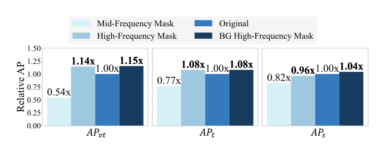

## Abstract

*Deep learning has significantly advanced the object detec-* *tion field.* *However,* *tiny object detection (TOD) remains a* *challenging problem.* *We provide a new analysis method to* *examine the TOD challenge through occlusion-based attri-* *bution* *analysis* *in* *the* *frequency* *domain.* *We* *observe* *that* !"!" !"" !"# *tiny objects become less distinct after feature encoding and* Figure 1. A feature-level occlusion-based attribution analysis in *can benefit from the removal of high-frequency information.* the frequency domain. Mid-frequency features ranges from 40% *In this paper, we propose a novel approach named S pectral* to 60% of the total energy, high-frequency features are above 90% of the total energy. The model is trained on the AI-TOD [44] ***E nhancement* *for* ***T iny* *object* *detection* *(SET),* *which* *am-* trainval and validated on the AI-TOD test. Detection per- *plifies* *the* *frequency* *signatures* *of* *tiny* *objects* *in* *a* *hetero-* formance is evaluated by inferencing a 1*×* FCOS detector [39] *geneous architecture.* *SET includes two modules.* *The Hier-* with the masked features. Results exhibit that tiny objects are more *archical* *Background* *Smoothing* *(HBS)* *module* *suppresses* likely to be affected by high-frequency noise and can benefit from *high-frequency* *noise* *in* *the* *background* *through* *adaptive* the direct removal of high-frequency information.

*smoothing operations.* *The Adversarial Perturbation Injec-* *tion* *(API)* *module* *leverages* *adversarial* *perturbations* *to* DINO [60], one of the most representative transformer- *increase feature saliency in critical regions and prompt the* based object detector, achieves 37.6% AP on medium-sized *refinement of object features during training.* *Extensive ex-* objects but only 9.9% AP on very tiny objects on the AI- *periments on four datasets demonstrate the effectiveness of* TOD [44] benchmark, Moreover, the vanilla FCOS [39] *our method.* *Especially,* *SET boosts the prior art RFLA by* achieves only 2.5% AP on very tiny objects on the AI- *3.2% AP on the AI-TOD dataset.* TOD [44], which is far from sufficient to meet the de- mands of real-world applications, such as autonomous driv-

## 1. Introduction

ing, maritime rescue, and traffic management.

Constrained by the inherently low resolution, one key Recent advances in Deep Neural Networks (DNNs) [14,60] challenge in TOD is to extract discriminative foreground have significantly improved the object detection field [11, features [7], especially in the high-level features of de- 22]. Despite the progress, Tiny Object Detection (TOD) re- tection architecture after down-samplings.

In the mean- mains a challenging problem. Tiny objects, characterized time, it is difficult to learn about tiny objects from the by their very limited pixel input, occupy areas equal to or noisy and dominant background clutter [54]. Most existing less than 16×16 pixels [44]. Compared to traditional ob- works [1, 3, 30, 54] focus on enhancing feature represen- ject detection [10, 21], generic object detectors often fail

tations of tiny objects in the spatial domain. We provide a

to manifest effectiveness on the TOD task. For instance,

new analysis method and address the challenge from a fre-

quency spectrum perspective.

*Corresponding authors. Email:sunhuixin@buaa.edu.cn

4713

<!-- Page 2 -->

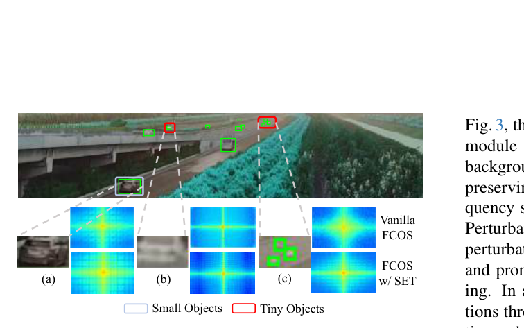

Fig.3, the first Hierarchical Background Smoothing (HBS) module suppresses the high-frequency information in the background through adaptive smoothing operations while preserving foreground details, thereby accentuating the fre- quency signatures of tiny objects. The second Adversarial

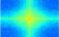

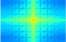

Vanilla Perturbation Injection (API) module leverages adversarial FCOS

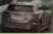

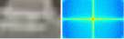

perturbations to increase feature saliency in critical regions

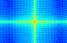

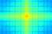

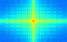

FCOS and prompt the refinement of object features during train- (c) (a) (b) w/ SET ing. In addition, API facilitates robust feature representa- tions through adversarial training. SET is simple yet effec- Small Objects Tiny Objects tive and can be easily mounted on existing detectors during Figure 2. The analysis examines different objects after feature en- the training process while bringing no extra burden to the coding in the frequency domain. The frequency spectrum is calcu- inference procedure.

lated using the Fast Fourier Transform (FFT) [31] on the cropped Our major contributions in this paper are summarized as:

*P*3 feature and selecting the channel with the highest energy. The

- A feature-level occlusion-based attribution analysis from

frequency signatures of tiny objects become more pronounced af- the frequency spectrum perspective is conducted to inves- ter applying SET, manifesting distinct frequency response on the edges of the spectrum compared to vanilla FCOS.

tigate the Tiny Object Detection (TOD) challenge, which

shows that tiny objects are more likely to be affected by Motivated by occlusion-based attribution analysis [33, high-frequency noise. We introduce a spectral enhance- 45], we perform an occlusion-based analysis on the inter- ment scheme for tiny object detection (SET) by design- mediate Feature Pyramid Network (FPN) features to exam- ing a heterogeneous architecture for foreground and back- ine the impact of masking specific frequency bands on the ground feature refinement.

detection performance across object scales. Specifically, we

- Two new modules are designed for the TOD task. The

transform the features into the frequency domain using the HBS module is used to suppress the high-frequency noise n-dimensional Fast Fourier Transform (FFT) [31] and ap- in the background through adaptive smoothing opera- ply static filters to the amplitude spectrums, which are then tions. The API module leverages adversarial perturba- fed to Inverse Fast Fourier Transform (IFFT) with phase tions to increase feature saliency in critical regions and spectrums to generate the masked spatial features. **High-** prompt the refinement of object features during training.

**frequency mask**results in Fig.1reveal that directly remov-

- Extensive results reveal that our SET boosts the well-

ing high-frequency features has a positive effect on very tiny known baselines and the prior art by a large margin.

and tiny objects, while negatively affecting the detection of larger objects. The disparity can be attributed to that tiny

## 2. Related Work

objects become less distinct after feature encoding, exhibit- ing weak high-frequency components (example (b), Fig.2) **Tiny** **Object** **Detection**. Most current approaches for tiny and extremely vague frequency signatures in the cluttered object detection (TOD) can be grouped into four main cate- background (example (c), Fig.2). Therefore, they are more gories: data augmentation, multi-scale feature learning, la- likely to be affected by high-frequency noise and benefit bel assignment, and feature enhancement strategies for tiny from the direct removal of high-frequency information. In objects. Several data augmentation strategies [6,37] target contrast, larger objects exhibit distinct high-frequency sig- tiny objects by prompting the detector to focus on instances

natures (example (a), Fig.2) and have a higher dependency of specific scales during training. Conventional approaches on high-frequency information. Based on the observations, also utilize multi-scale feature learning [23, 26, 62]. An- we investigate an explicit measure to enhance the frequency other method line focuses on improving tiny object detec- signatures for tiny objects by removing the high-frequency tion from the label assignment and proposal refinement per- information in the background. **Background** **(BG)** **high-** spectives [52, 58]. Various works aim to enhance the fea- **frequency** **mask** results show that the approach enhances ture representations of tiny objects. Yuan*et al.*[58] propose detection performance across all three object scales, result- a Feature Imitation (FI) mechanism, aligning RoI features ing in improvements of 15%, 8%, and 4%, bringing signif- with their counterparts in an exemplar feature set within icant gains for very tiny and tiny objects without compro- the embedding space. Recent state-of-the-art TOD methods mising larger objects.

have proposed auxiliary self-reconstruction branches to en- In light of the analysis above, we propose a generic hance the weak representations of tiny objects [3,54]. Dif- **S**pectral **E**nhancement (SET) method to enhance the fre- ferently, our proposed method enhances the discrimination

quency signatures of **T**iny objects using a heterogeneous

of tiny objects from a frequency perspective, prompting the

architecture for foreground and background feature refine-

refinement of object features during training without adding

ment. The method includes two modules. As illustrated in

any extra burden to the inference process.

4714

<!-- Page 3 -->

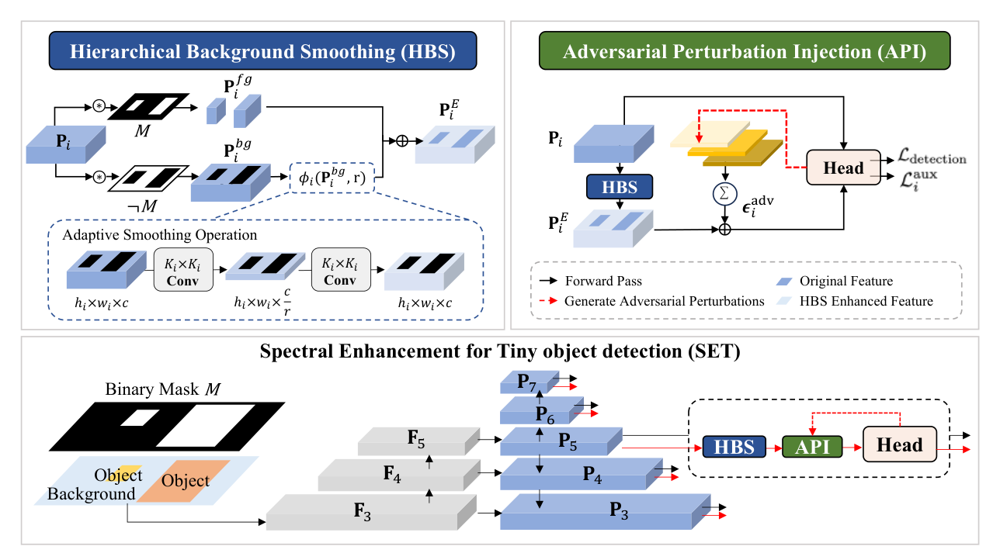

**Adversarial Perturbation Injection (API)** **Hierarchical Background Smoothing (HBS)** "# !!

( ⊛ !!

M !!

!!

'# !!

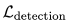

**Head** "#, r) %&

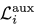

⊛ "!($!

!$ **HBS** " )*+ ¬M $!

( !!

Adaptive Smoothing Operation &!×&!

&!×&!

**Conv** **Conv** Forward Pass Original Feature ℎ!×#!×$ Generate Adversarial Perturbations HBS Enhanced Feature ℎ!×#!×$ ℎ!×#!×$ % **Spectral Enhancement for Tiny object detection (SET)** !% Binary Mask M !!

"" !" **Head** **API** **HBS** "# !# Object Object Background !$ "$ Figure 3. Overview of the proposed SET method with FCOS framework. The red dashed line denotes generating the adversarial pertur- bations *ϵ*adv *i* . The HBS module can suppress the high-frequency noise in the background through scale-wise smoothing operations. The API module leverages adversarial perturbations to increase feature saliency in critical regions and facilitate robust feature representations through adversarial training.

**3.1. Hierarchical Background Smoothing** **Adversarial** **Training** **for** **Object** **Detection**.

Many ef- fective attacks crafted for object detectors have been pro- Based on the analysis in Sec. 1, we design a Hierarchi- posed, with most generating adversarial examples at the im- cal Background Smoothing (HBS) module to suppress the age level [28, 38, 48]. The most common method to de- high-frequency information in the background feature while fend against the attacks is adversarial training [20,29,40], preserving foreground details, thereby accentuating the fre- which involves augmenting training datasets with adversar- quency signatures of tiny objects. This is achieved through ial examples. For object detection, [59] extend adversarial background feature decoupling and adaptive smoothing, as training to the scenario of object detection by leveraging the described below.

attacks sourced from both classification and localization do- Given an input image*X* *∈*R3*×**W**×**H*, a binary mask*M* mains. Different from the aforementioned methods, we in- is generated according to the ground truth box*B*:

troduce feature-level adversarial perturbations that balance (1) *M**i,j* =**1**[(*i, j*)*∈**B*]*,* the detection semantics across branches for enhanced tiny object detection, resulting in more salient foreground fea- where*M* *∈{*0*,*1*}**W**×**H*. The indicative function**1**denotes tures and improved model robustness.

the value of location(*i, j*), which is1if it belongs to an ob- ject and0otherwise. Then we utilize the generated binary mask to decouple image features and perform background

## 3. Methods

smoothing, as shown in Fig. 3. In a Feature Pyramid Net- work (FPN) comprising *N* layers, the feature of the *i*-th This section presents the Spectral Enhancement (SET) layer is denoted as**P***i**,*(*i**∈*[1*, N*]). The process of HBS on method for Tiny object detection, depicted in Fig. 3. SET the*i*-th layer is as follows:

employs a heterogeneous architecture. This includes the *i* =**P***fg* +*φ**i*(**P***bg* Hierarchical Background Smoothing (HBS) module, which **P***E* *i* *, r*) *i* (2) suppresses high-frequency information in the background, =**P***i*⊛*M* +*φ**i*(**P***i*⊛*¬**M, r*)*,*

and the Adversarial Perturbation Injection (API) module,

*i* ,**P***fg*

and**P***bg*

which enhances the feature saliency of critical regions and

where**P***E*

*i* denote the enhanced feature, fore-

*i*

prompts the refinement of object features during training.

ground feature and background feature,*¬**M* represents the

4715

<!-- Page 4 -->

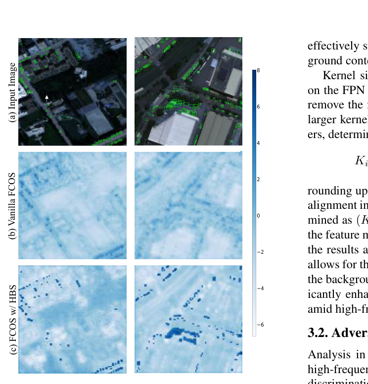

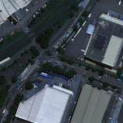

effectively suppressing noise without losing essential back-

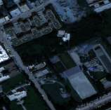

ground context.

(a) Input Image Kernel size *K**i* at each scale level is determined based

on the FPN stride*S**i*, where smaller kernels are utilized to remove the fine-grained details in lower feature layers and larger kernels for more coarse-grained noise in higher lay- ers, determined as:

!"log2(*S**i*) # $

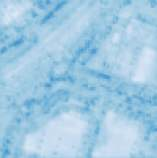

(4) *×*2 *K**i* =*g*(*S**i*) = + 1*,* 2 (b) Vanilla FCOS rounding up*S**i* to an odd integer and ensuring central pixel alignment in the convolutional kernel. The padding is deter- mined as(*K**i**−*1)*/*2to preserve the spatial dimensions of the feature map. In addition, we also tested other*g*(*S**i*), and the results are shown in the Tab. 5. The HBS architecture allows for the suppression of high-frequency information in

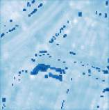

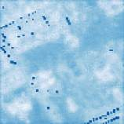

the background while preserving foreground details, signif- (c) FCOS w/ HBS icantly enhancing the frequency signatures of tiny objects amid high-frequency noise.

**3.2. Adversarial Perturbation Injection** Analysis in Sec. 1 reveals that tiny objects exhibit weak high-frequency signatures after feature encoding and low

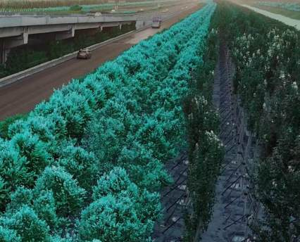

discrimination against the cluttered background. To address Figure 4. We visualize (a) the input image with ground-truths this, we design an Adversarial Perturbation Injection (API) shown in green boxes, (b) *P*3 feature in the vanilla FCOS after module, which leverages adversarial perturbations to en- Principal Component Analysis (PCA) [46], and (c) *P*3 feature in hance the saliency in critical regions. In addition, API pro- FCOS enhanced with HBS after PCA. Darker colors in the PCA motes robust feature representations for tiny objects through maps indicate more critical components in the feature. As shown, adversarial training.

HBS smooths the background regions and significantly enhances Inspired by prior works in adversarial training [16, 17, the contrast between the foreground and background.

42], we exploit feature-level perturbations that adversarially change the model output to enhance feature representations.

complement of the binary mask*M*, and⊛is the Hadamard The objective of API for each FPN layer is formulated as product with broadcasting to accommodate the dimensions.

follows:

Previous works [18, 41] reveal that feature dimensionality !

$ reduction methods can lead to smoother and more efficient *∥**ϵ**i,*cls*∥≤**ρ* *L*cls(**P***i*+*ϵ**i,*cls) +*γ**∥***P***i**∥*2 (5) min max *,* 2 feature spaces. Based on this idea, we design an adaptive **P***i**,θ**i* smoothing operation*φ**i*(·*, r*)with channel reduction rate*r*, where *L*cls denotes the classification loss. The inner opti- formulated as:

mization injects adversarial perturbation *ϵ**i,*cls into the fea- *φ**i*(**P**bg *i* *⊗***P**bg *i* )) +**P**bg *i* *, r*) =*σ*(**w**e *i* *⊗**σ*(**w**r ture space of**P***i*, where*ρ*defines the perturbation size, and (3) *i* *,* *γ* is a hyperparameter that controls the strength of regular- where *⊗*represents the convolution operation and **w**r *i* *∈* ization. *θ**i* denotes the model parameters at the *i*-th layer.

R*C**i**×**C**i/r**×**K**i**×**K**i* and **w**e *∈*R*C**i/r**×**C**i**×**K**i**×**K**i* are the We derive a closed-form solution for the adversarial pertur- *i* weights of the channel reducing and expanding kernels, bation under the*L*2 norm following [12]:

respectively.

*σ* denotes the non-linear function ReLU.

*∇***P***i**L*cls(**P***i*) The reduction step compresses information while retain- *ϵ**∗* (6) *i,*cls *≈**ρ* · *.* *∥∇***P***i**L*cls(**P***i*)*∥*2 ing salient features. When features are expanded, the high- frequency information are difficult to be recreated, resulting The perturbation can elevate the gradient of critical regions, in a smoother background. The effectiveness of smooth- thereby increasing their saliency during training. The gradi- ing is exhibited through statistical analysis in Sec.4.7. The ent change induced by the perturbation on the classification smoothing effect is further visualized through PCA analy- branch can be calculated as:

sis. As shown in Fig.4, feature maps enhanced with HBS

%%*∇***P***i*

'%%*.*

&

exhibit a reduced intensity range and smoother transitions

*L*cls(**P***i*+*ϵ**∗*

∆(*∇***P***i**L*cls) =

*i,*cls)*−L*cls(**P***i*)

in the background regions compared to the vanilla FCOS,

(7)

4716

<!-- Page 5 -->

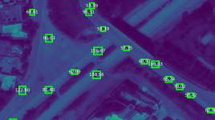

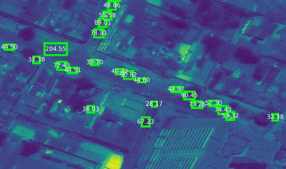

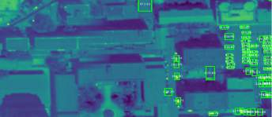

(a) Vanilla FCOS **Average Tiny Object Saliency: 98.46** **Average Small Object Saliency: 174.11** **Average Tiny Object Saliency: 53.99** **Average Tiny Object Saliency: 68.09** **Average Medium Object Saliency: 798.63** **Average Small Object Saliency: 186.83** **Average Small Object Saliency: 167.23**

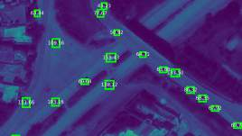

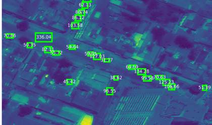

(b) FCOS w/ API **Average Tiny Object Saliency: 105.50** **Average Tiny Object Saliency: 73.85** **Average Small Object Saliency: 185.93** **Average Tiny Object Saliency: 69.93** **Average Small Object Saliency: 172.52** **Average Medium Object Saliency: 793.44** **Average Small Object Saliency: 275.38** Figure 5. Average saliency visualization in (a) FCOS and (b) FCOS w/ API. The saliency maps are first computed based on the*ℓ*2-norm of the gradient [13] at neck feature*P*3. The saliency of each object is then summed and annotated within their respective bounding box, which is different between (a) and (b). The average saliency of each object scale is calculated as the mean saliency across objects in the corresponding size category, displayed in the bottom-left corner of each image.

*N* High∆(*∇***P***i**L*cls)corresponds to regions where model out- ( *L*aux *i* +*ϵ*adv *i* (**P***E* (9) *L*=*L*detection+*λ* · *i* ) *,* puts are highly sensitive to minor changes in activations, indicating the presence of semantic information about the *i*=1 ) *+ , image [49].

This elevated gradient enhances the feature auxiliary loss where*L*aux saliency of these critical regions and prompts the refinement denotes the auxiliary loss component for the*i*- *i* of object features during training. The effect particularly th layer, which is summed and scaled by a balancing hyper- parameter *λ*. The perturbation *ϵ*adv benefits tiny objects as they exhibit weak high-frequency is applied to the HBS- *i* signatures and face a training deficiency problem. The en- enhanced feature **P***E* *i* . The auxiliary optimization process hanced object saliency phenomenon is discussed in Sec.4.6 updates the model’s parameters in concert with the orig- through Fig.5. Furthermore, the adversarial training facil- inal loss, leading to more robust and discriminative fea- itates robust feature representations and reduces the sensi- tures for tiny objects. We visualize the effectiveness of the tivity to high-frequency noise [63], thereby enhancing the method in Fig.2. The frequency signatures of tiny objects discrimination of tiny objects.

become more pronounced after applying SET, manifesting distinct frequency response on the edges of the spectrum We formulate the adversarial perturbation *ϵ*adv for each *i* compared to vanilla FCOS, benefiting their detection amid FPN layer as an expectation over *M* object detection high-frequency noise and in the presence of larger objects.

branches (e.g., the classification, regression and center-ness branch in a FCOS detector [39]), each scaled by a corre-

## 4. Experiments

sponding balancing parameter*λ**m*. This is generated as fol- lows:

**4.1. Datasets and Implementation Details** *M* ( *ϵ*adv *λ**m* ·*ϵ**∗* **Datasets**.

We evaluate the proposed method on **AI-** (8) = *i,m**,* *i* **TOD** [44], **VisDrone2019** [65], **DOTA-v2.0** [47] and *m*=1 **COCO**2017[22]. The main experiments were conducted where *ϵ**∗* *i,m* represents the adversarial perturbation for the using the AI-TOD dataset, with an average object size of *m*-th branch. The design allows for a balanced incorpora- 12.8 pixels, substantially smaller than other object detec- tion of detection semantics across multiple branches, ensur- tion datasets such as PASCAL VOC (156.6 pixels) [10] and ing that the perturbations are distributed for more effective MS COCO (99.5 pixels) [21]. Furthermore, we test our training.

method on the VisDrone2019 [65] and DOTA-v2.0 [47], which comprises high-resolution drone-shot images with **3.3. Auxiliary Optimization** a substantial proportion of tiny instances.

We also con- The optimization leverages a total loss function that inte- duct experiments on the general object detection benchmark

grates both the original detection loss*L*detection and an aux-

COCO2017[22], incorporating AP*vt*, AP*t*, AP*s*metrics to

iliary loss derived from the HBS and API enhanced features.

evaluate objects of very tiny (2-8 pixels), tiny (8-16 pixels)

This joint loss function is defined as:

and small (16-32 pixels), following [44].

4717

<!-- Page 6 -->

Table 1. Main results with various frameworks on AI-TOD [44]. Models are trained on the AI-TOD trainval and validated on the AI-TODtest. We report APs (%) with different IoU thresholds and APs (%) for objects of various sizes based on the AI-TOD criterion.

RFLA is based on Cascade R-CNN. The *denotes using P2*∼*P6 FPN features. The**bold**indicates the best result.

|Framework|AP|AP0.5 AP0.75|APvt|APt|APs|
|---|---|---|---|---|---|
|PAA [19]|10.0|26.5 6.7|3.5|10.5|13.1|
|ATSS [61]|11.6|28.5 7.6|2.5|11.9|15.9|
|Centernet [9]|13.4|39.2 5.0|3.8|12.1|17.7|
|DetectoRS [34]|14.8|32.8 11.5|0.0|10.8|18.3|
|DotD [50]|16.1|39.2 10.6|8.3|17.6|18.1|
|DetectoRS w/NWD [43]|20.8|49.3 14.3|6.4|19.7|29.6|
|DetectoRS w/ SR-TOD [3]|24.0|54.6 17.1 One-stage|10.1|24.8|29.3|
|RetinaNet [24]|7.2|20.5 3.6|2.5|6.8|11.0|
|RetinaNet w/ SET|9.1|24.6 5.2|2.9|8.2|12.8|
|RetinaNet* [24]|13.3|31.7 8.6|3.9|14.4|17.7|
|RetinaNet* w/ QueryDet [55]|12.2|29.3 7.3|2.4|10.5|18.5|
|RetinaNet* w/ SET|16.5|38.6 10.9|5.0|15.7|21.8|
|FCOS [39]|12.0|29.0 8.0|2.5|11.9|17.1|
|FCOS w/ SET|14.2|34.9 9.8|2.9|13.0|20.2|
|FCOS* [39]|15.1|35.8 10.2|5.9|16.6|18.8|
|FCOS* w/ SET|18.0|42.7 12.4 Multi-stage|7.2|18.5|23.0|
|Faster R-CNN [35]|11.1|26.3 8.1|0.0|7.2|23.3|
|Faster R-CNN w/ SET|12.2|28.2 9.7|0.1|9.1|24.3|
|Cascade R-CNN [2]|13.6|30.3 10.6|0.0|9.9|25.5|
|Cascade R-CNN w/ SET|14.8|32.4 11.2|0.4|10.8|26.7|
|RFLA [52]|21.7|50.5 15.3|8.3|21.8|24.5|
|RFLA w/ SR-TOD [3]|21.8|50.8 15.4|9.7|21.8|27.4|
|RFLA w/ SET|24.9|55.6 17.9 Transformer-based|9.8|25.2|31.0|
|DINO-5scale [60]|23.2|56.6 15.4|9.9|23.1|29.3|
|DINO-5scale w/ DNTR [25]|26.2|56.7 20.2|12.8|26.4|31.0|
|DINO-5scale w/ SET|26.6|57.1 20.8|13.2|27.1|31.5|

**Implementation** **Details**. We conducted the experiments all baselines by about 2% AP, which is significant. Specifi- on a computer with an NVIDIA RTX 3090 GPU. The ex- cally, SET improves the one-stage detector FCOS [39] and periments are implemented with PyTorch [32], with core RetinaNet [24] by 2.2%/1.9% AP and 1.1%/1.4% AP*t*, re- codes built upon MMdetection [5]. The ImageNet [36] spectively. We further revise the detector architecture and pre-trained models are used as the backbones. All CNN- use P2*∼*P6 FPN features, a representative approach for based models utilize the ResNet-50 [15] backbone, trained TOD tasks where the high-resolution P2 layer benefits tiny using the Stochastic Gradient Descent (SGD) optimizer for objects. With the adjustment, SET boosts the RetinaNet and 12 epochs with 0.9 momentum, 0.0001 weight decay, and FCOS baselines by 3.2%/2.9% AP and 1.1%/1.3%AP*vt*, a batch size 2. The initial learning rate is 0.005, decay- a significant margin. In contrast, the state-of-the-art SOD ing at the 8th and 11th epochs. The data processing ad- method QueryDet [55] decreases the baseline performance, heres to the default configurations of each dataset (e.g, fixed showing limitations in addressing the TOD challenge. SET at 800*×*800 for AI-TOD). We also train a transformer- also generalizes to multi-stage detectors, enhancing the based detector, DINO [60], with 5-scale feature maps for Faster R-CNN [35] and Cascade R-CNN [2] baselines by 36 epochs as a baseline. The training uses an Adam opti- 1.1%/1.2% AP and 1.9%/1.1% AP*t* respectively.

mizer with a weight decay of 0.0001, following the random SET works orthogonally with the state-of-the-art TOD crop and scale augmentation strategies of DETR [4].

method RFLA [52], achieving a 3.2% AP increment over the RFLA baseline and surpassing the comparison SR- **4.2. Results on AI-TOD** TOD [3] by 3.1% AP and 3.4% AP*t*.

We also inves-

We evaluate the proposed SET method on various detectors

tigate SET’s compatibility with transformer-based detec-

and compare it with state-of-the-art TOD methods on the

tors.

As shown, SET results in 3.4% AP increase over

AI-TOD benchmark [51]. Tab.1shows that SET enhances

the DINO-5scale [60] baseline, outperforming the prior

4718

<!-- Page 7 -->

Table 2. Detection performance on the VisDrone2019 [65] valida- Table 3. Detection performance on DOTA-v2.0 [8]. Note that tion set. RFLA is based on Cascade R-CNN. The**bold**denotes the models are trained on the DOTA-v2.0trainand validated on the DOTA-v2.0val. The**bold**denotes the best result.

best result.

|Framework|AP|APvt|APt|APs|Framework|AP|APvt|APt|APs|
|---|---|---|---|---|---|---|---|---|---|
|RetinaNet [24]|15.2|0.4|1.6|9.3|ATSS [61]|32.7|0.7|6.9|23.4|
|Faster R-CNN [35]|23.1|0.1|5.1|19.6|Faster R-CNN [35]|35.6|0.0|7.1|28.9|
|FCOS [39]|19.9|0.7|4.5|15.7|FCOS [39]|31.8|0.3|4.0|19.4|
|FCOS w/ SET|21.9|1.6|5.7|17.9|FCOS w/ RFLA [52]|32.1|0.7|6.8|23.6|
|Cascade R-CNN [2]|23.0|0.1|5.0|19.4|FCOS w/ DCFL [53]|33.8|0.5|6.9|24.2|
|Cascade R-CNN w/ SET|24.3|1.2|6.3|21.0|FCOS w/ SET|34.7|0.6|7.1|24.8|
|RFLA [52]|27.2|4.5|13.0|23.6|AutoAssign [64]|33.8|0.9|7.3|22.4|
|RFLA w/ SR-TOD [3]|27.8|4.8|13.1|24.5|AutoAssign w/ SET|35.2|1.1|8.6|23.6|
|RFLA w/ SET|28.5|5.2|13.5|24.6||||||

Table 4.

Detection performance on MS COCO [21].

Note that models are trained on COCOtrain2017and validated on COCOval2017. (·)+ denotes performance increment.

art DNTR [25].

Notably, DINO-5scale w/SET derives 26.6% AP, outperforming competitors including DotD [50], NWD [43], and SR-TOD [3]. The results demonstrate SET

|Framework|AP|APvt|APt|APs|APm|
|---|---|---|---|---|---|
|FCOS [39]|36.4|7.9|19.6|27.2|43.6|
|FCOS w/ SET|37.4+1.0|8.3+0.4|23.3+1.727.6+0.444.8+1.2|||

as a robust solution for the tiny object detection task.

**4.3. Results on VisDrone2019 and DOTA-V2.0** **Effectiveness and Cost of Components.** We present quan- We further evaluate SET on the drone-shot image bench- titative improvements of SET components in Tab. 5. As mark VisDrone2019 [65], which features tiny and small ob- shown, applying the adaptive smoothing operations to full jects. As shown in Tab.2, the proposed SET effectively im- features (+*φ**i*(**P***i**, r*)) achieves a 0.4% increase in AP and proves the performance of both one-stage and multi-stage 0.3% in AP*vt*, surpassing the performance of static high- detectors and exhibits consistent AP*vt* and AP*t* improve- frequency filtering in Fig. 1. With decoupling, the HBS ments. Specifically, SET improved the the one-stage detec- module boosts the overall AP by 1.9% AP and 0.4% AP*vt*.

tor FCOS by 2.0%/0.9%/1.2% AP, AP*vt* and AP*t*, respec- The API module alone achieves a 1.2% AP improvement.

tively. SET also improves multi-stage detector Cascade R- Combining HBS and API results in a total AP increase of CNN [2] by 1.1%/1.3% AP*vt* and AP*t*, respectively. No- 2.2%. Results demonstrate the synergy between the het- tably, SET improves the prior art RFLA, achieving a 28.5% erogeneous operations, where HBS effectively smooths the AP with 0.7% increment in AP*vt* and 0.5% in AP*t*.

clutter background and API prompts the learning of object Tab. 3 demonstrates the DOTA-v2.0 [8] results.

As features, cumulatively improving the detection accuracy of shown, SET obtains a substantial performance gain of 3.1% tiny objects. Tab. 5 also presents the cost of components.

and 1.3 % in AP*t* with the FCOS and AutoAssign base- Results show that the HBS module leads to 17%, 0.9%, and line, underscoring the efficacy of our method in detecting 0.9% increase in training time, computational and memory tiny objects. Compared to the state-of-the-art comparisons cost. The API module results in a more significant increase RFLA [52] and DCFL [53], SET achieves 2.6% and 0.9% in training time due to adversarial training but adds no for- AP gain, respectively. More experimental results on the ward computational cost and minimal increase in memory **TinyPerson**[56] and**SeaPerson**[57] dataset are provided usage. The overall minimal impact indicates that SET can in the supplementary material.

be implemented with negligible additional overhead.

**4.4. Results on COCO** **Hyper-parameter** **Selection.** We first select the hyper- parameters channel reduction rate *r* and perturbation size We further conduct experiments on the general object de- *ρ* using the FCOS [39] framework trained three epochs in tection benchmark MS COCO [21]. As shown in Tab. 9, Fig.6 (a). Model performance (AP) with different hyper- SET achieves 1.0% AP improvement over the FCOS base- parameter combinations *{**r*, *ρ**}* is presented. Results indi- line, with a notable 1.7% improvement in AP*t*, demonstrat- cate that performance initially improves and then declines ing that SET can enhance the detection of tiny objects in as*r*varies from 2 to 16, with*r* = 16perform worse than the general detection tasks.

baseline. Additionally, SET with adversarial perturbations (*ρ >*0) exhibits stronger performance than without (*ρ*= 0), **4.5. Ablation Study**

but large-sized perturbations (*ρ* = 5) performs worse than

In the following experiments, we explore the best structure

all alternatives. Exploring the setups, we identify *{**r*, *ρ**}*

of SET by ablating and tuning its parts using AI-TOD.

=*{*4, 1*}*as the combination for SET. Fig.6(b) explores the

4719

<!-- Page 8 -->

Table 5. The impact of different components and various channel reduction operations in SET. The hyper-parameters are fixed with channel reduction rate*r*being 4, perturbation size*ρ*being 1, and the balancing hyper-parameters*λ*of auxiliary optimization being 1.

|Framework|φi|||g(Si)||||AP|APvt|APt|Time(s/batch)|GFLOPs|Params (M)|
|---|---|---|---|---|---|---|---|---|---|---|---|---|---|
|FCOS [39]|-||||-|||12.0|2.5|11.9|0.17|126.13|37.04|
|+ φi(Pi, r)|-||||-|||12.7|2.7|12.9|0.17|127.36|37.41|
||Eqn. 3||||3|||13.4|2.7|12.6||||
||Eqn. 3|!||log2(Si) 2|"||× 2 + 1|13.9|2.7|12.9||||
|+ HBS|Eqn. 3||||5|||13.1|2.3|12.5|0.20|127.32|37.41|
||Eqn. 3|!|log2(Si+1) 2|||" × 2 −1||13.4|2.8|12.4||||
||Eqn. 3||||7|||12.1|2.5|12.2||||
|+ API|-||||-|||13.2|2.6|12.4|0.39|126.13|37.16|
|+ Both (SET)|Eqn. 3|||Eqn.|||4|14.2|2.9|13.0|0.42|127.32|37.85|

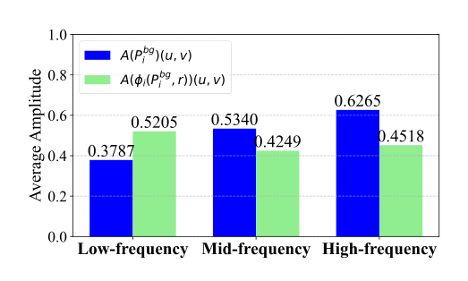

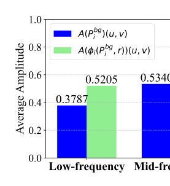

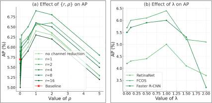

Figure 7. The analysis examines the adaptive smoothing opera- Figure 6. We select hyper-parameters channel reduction rate *r* tion, obtained from 1000 randomly selected images from the Vis- with perturbation size*ρ*in (a), and the balancing hyper-parameter Drone2019 [65] train set.

*λ*of Eqn.9in (b).

**4.7. Effectiveness in Smoothing** balancing hyper-parameter*λ*in Eqn.9that controls the pro- In Fig. 7, we perform a statistic analysis on *P* *bg* to inves- portion of the auxiliary optimization, using the FCOS [39], *i* tigate the adaptive smoothing operation. We convert fea- RetinaNet [24], and Faster R-CNN [35] framework. As ob- ture *P* *bg* and *φ**i*(*P* *bg* *i* *, r*) into the frequency space using served, the performances increase first and then decrease *i* FFT [31] and separate the amplitude spectrums of these with the increase of *λ*, with *λ* = 1 yielding the best per- features into three parts (low-, mid-, and high-frequency) formance across all frameworks. However, the efficacy of using static thresholds as Fig. 1. The amplitudes in each SET diminishes when *λ* exceeds the 1, as larger-sized *λ* band are then summed and averaged to measure the signal (*λ* *>* 1) can impose too strong regularization to the detec- strength. Results verify that the channel reducing and ex- tor, reducing the detection accuracy despite increasing ro- pand design effects in smoothing. Comparing*A*(*P**i*)(*u, v*) bustness. Therefore, we set the hyper-parameter*λ*to1for and*A*(*φ**i*(*P* *bg* *i* *, r*))(*u, v*), the low-frequency signals are en- experiments in this paper.

hanced (from 0.3787 to 0.5205), while mid- and high- **4.6. Enhanced Object Saliency** frequency signals are attenuated.

We demonstrate effectiveness of API in increasing the

## 5. Conclusion

saliency of object features in Fig. 5. Comparing the aver- age saliency of each object scale, tiny objects are the least This paper proposes the Spectral Enhancement for Tiny salient due to their inherently limited pixel input. API leads objects (SET) method, which amplifies the frequency sig- to a notable increase in the average saliency of tiny objects natures of tiny objects in a heterogeneous architecture.

(e.g., from 53.99 to 69.93), benefited from the injection of SET includes two modules. The Hierarchical Background perturbations (Eqn.7). Fig. 5 also demonstrates that API Smoothing (HBS) module suppresses high-frequency noise can enhance the feature saliency of small and medium ob- in the background through adaptive smoothing operations.

jects, though the degree of improvement is less. The com- The Adversarial Perturbation Injection (API) module lever-

parison underscores that API could benefit general object

ages adversarial perturbations to prompt the refinement of

detection, with more significant and essential improvements

object features during training. Extensive experiments on

for tiny objects.

four datasets demonstrate its effectiveness.

4720

<!-- Page 9 -->

**Acknowledgments.** The work was supported by [12] Pierre Foret, Ariel Kleiner, Hossein Mobahi, and Behnam the National Natural Science Foundation of China Neyshabur.

Sharpness-aware minimization for efficiently (No.

61827901, 623B2016, and 62406298).

This improving generalization. *arXiv preprint arXiv:2010.01412*, research was also supported by the National Key Re-

2020. 4,1

search and Development Program of China (Grant No.

[13] Jianyuan Guo, Kai Han, Yunhe Wang, Han Wu, Xinghao 2023YFC3306401), Zhejiang Provincial Natural Science Chen, Chunjing Xu, and Chang Xu. Distilling object de- Foundation of China under Grant No.

LD24F020007, tectors via decoupled features. In*CVPR*, pages 2154–2164, Beijing Natural Science Foundation L223024, L244043

2021. 5,1

and Z241100001324017, “One Thousand Plan” projects [14] Kaiming He and Jian Sun. Convolutional neural networks at in Jiangxi Province Jxsq2023102268, and the Beijing constrained time cost. In*CVPR*, pages 5353–5360, 2015. 1 Jiaotong University “Jingying Plan” No. K24XKRC00130.

[15] Kaiming He, Xiangyu Zhang, Shaoqing Ren, and Jian Sun.

Deep residual learning for image recognition.

In *CVPR*,

2016. 6

## References

[16] Yanxu Hu and Andy J Ma. Adversarial feature augmentation for cross-domain few-shot classification. In *ECCV*, pages [1] Yancheng Bai, Yongqiang Zhang, Mingli Ding, and Bernard 20–37. Springer, 2022. 4 Ghanem. Sod-mtgan: Small object detection via multi-task [17] Masato Ishii and Atsushi Sato.

Training deep neural net- generative adversarial network. In *ECCV*, pages 206–221, works with adversarially augmented features for small-scale

2018. 1

training datasets. In*IJCNN*, pages 1–8. IEEE, 2019. 4 [2] Zhaowei Cai and Nuno Vasconcelos. Cascade r-cnn: Delving [18] Weikuan Jia, Meili Sun, Jian Lian, and Sujuan Hou. Feature into high quality object detection. In *CVPR*, pages 6154– dimensionality reduction: a review. *Complex* *&* *Intelligent* 6162, 2018. 6,7 *Systems*, 8(3):2663–2693, 2022. 4 [3] Bing Cao, Haiyu Yao, Pengfei Zhu, and Qinghua Hu. Visible [19] Kang Kim and Hee Seok Lee. Probabilistic anchor assign- and clear: Finding tiny objects in difference map. *ECCV*, ment with iou prediction for object detection.

In *ECCV*,

2024. 1,2,6,7

pages 355–371, 2020. 6 [4] Nicolas Carion, Francisco Massa, Gabriel Synnaeve, Nicolas [20] A. Kurakin, I. Goodfellow, and S. Bengio. Adversarial ex- Usunier, Alexander Kirillov, and Sergey Zagoruyko. End- amples in the physical world. In*ICLR*, 2016. 3 to-end object detection with transformers. In *ECCV*, pages [21] Tsung-Yi Lin, Michael Maire, Serge Belongie, James Hays, 213–229, 2020. 6 Pietro Perona, Deva Ramanan, Piotr Doll´ar, and C Lawrence [5] Kai Chen, Jiaqi Wang, Jiangmiao Pang, Yuhang Cao, Yu Zitnick. Microsoft coco: Common objects in context. In Xiong, Xiaoxiao Li, Shuyang Sun, Wansen Feng, Ziwei Liu, *ECCV*, pages 740–755, 2014. 1,5,7,3 Jiarui Xu, et al. Mmdetection: Open mmlab detection tool- [22] Tsung-Yi Lin, Michael Maire, Serge Belongie, James Hays, box and benchmark.*arXiv preprint arXiv:1906.07155*, 2019.

Pietro Perona, Deva Ramanan, Piotr Doll´ar, and C Lawrence 6 Zitnick. Microsoft coco: Common objects in context. In [6] Yukang Chen, Peizhen Zhang, Zeming Li, Yanwei Li, *ECCV*, pages 740–755. Springer, 2014. 1,5 Xiangyu Zhang, Lu Qi, Jian Sun, and Jiaya Jia.

Dy- [23] Tsung-Yi Lin, Piotr Doll´ar, Ross Girshick, Kaiming He, namic scale training for object detection.

*arXiv* *preprint* Bharath Hariharan, and Serge Belongie.

Feature pyramid *arXiv:2004.12432*, 2020. 2 networks for object detection. In *CVPR*, pages 2117–2125, [7] Gong Cheng, Xiang Yuan, Xiwen Yao, Kebing Yan, Qinghua

2017. 2

Zeng, Xingxing Xie, and Junwei Han. Towards large-scale [24] Tsung-Yi Lin, Priya Goyal, Ross Girshick, Kaiming He, and small object detection:

Survey and benchmarks.

*IEEE* Piotr Doll´ar. Focal loss for dense object detection. In*ICCV*, *TPAMI*, 2023. 1 pages 2980–2988, 2017. 6,7,8,2,3 [8] Jian Ding, Nan Xue, Gui-Song Xia, Xiang Bai, Wen Yang, [25] Hou-I Liu, Yu-Wen Tseng, Kai-Cheng Chang, Pin-Jyun Michael Ying Yang, Serge Belongie, Jiebo Luo, Mihai Wang, Hong-Han Shuai, and Wen-Huang Cheng. A denois- Datcu, Marcello Pelillo, et al.

Object detection in aerial ing fpn with transformer r-cnn for tiny object detection.*IEEE* images: A large-scale benchmark and challenges.

*IEEE* *Transactions on Geoscience and Remote Sensing*, 2024. 6,7 *TPAMI*, 44(11):7778–7796, 2021. 7 [26] Wei Liu, Dragomir Anguelov, Dumitru Erhan, Christian [9] Kaiwen Duan, Song Bai, Lingxi Xie, Honggang Qi, Qing- Szegedy, Scott Reed, Cheng-Yang Fu, and Alexander C ming Huang, and Qi Tian. Centernet: Keypoint triplets for Berg. Ssd: Single shot multibox detector. In *ECCV*, pages object detection. In*ICCV*, pages 6569–6578, 2019. 6 21–37, 2016. 2 [10] Mark Everingham, Luc Van Gool, Christopher KI Williams, [27] Ze Liu, Yutong Lin, Yue Cao, Han Hu, Yixuan Wei, Zheng John Winn, and Andrew Zisserman. The pascal visual object Zhang, Stephen Lin, and Baining Guo. Swin transformer:

classes (voc) challenge. *ICCV*, 88:303–308, 2009. 1,5 Hierarchical vision transformer using shifted windows. In *ICCV*, pages 10012–10022, 2021. 3 [11] M. Everingham, L. Van Gool, C. K. I. Williams, J. Winn,

and A. Zisserman.

The pascal visual object classes (voc)

[28] Jiajun Lu, Hussein Sibai, and Evan Fabry. Adversarial ex-

challenge. *International Journal of Computer Vision*, 88(2):

amples that fool detectors.*arXiv preprint arXiv:1712.02494*,

303–338, 2010. 1

2017. 3

4721

<!-- Page 10 -->

[45] Kunyu Wang, Xueyang Fu, Yukun Huang, Chengzhi Cao, [29] T. Na, J. H. Ko, and S. Mukhopadhyay. Cascade adversarial Gege Shi, and Zheng-Jun Zha. Generalized uav object de- machine learning regularized with a unified embedding. In *ICLR*, 2017. 3 tection via frequency domain disentanglement.

In *CVPR*, pages 1064–1073, 2023. 2 [30] Junhyug Noh, Wonho Bae, Wonhee Lee, Jinhwan Seo, and Gunhee Kim. Better to follow, follow to be better: Towards [46] Svante Wold, Kim Esbensen, and Paul Geladi.

Principal precise supervision of feature super-resolution for small ob- component analysis. *Chemometrics* *and* *intelligent* *labora-* *tory systems*, 2(1-3):37–52, 1987. 4,2 ject detection. In*ICCV*, pages 9725–9734, 2019. 1 [31] Henri J Nussbaumer and Henri J Nussbaumer.

*The* *fast* [47] Gui-Song Xia, Xiang Bai, Jian Ding, Zhen Zhu, Serge Be- *Fourier transform*. Springer, 1982. 2,8 longie, Jiebo Luo, Mihai Datcu, Marcello Pelillo, and Liang- pei Zhang. Dota: A large-scale dataset for object detection [32] Adam Paszke, Sam Gross, Francisco Massa, Adam Lerer, in aerial images. In*CVPR*, pages 3974–3983, 2018. 5 James Bradbury, Gregory Chanan, Trevor Killeen, Zeming Lin, Natalia Gimelshein, Luca Antiga, et al. Pytorch: An [48] Cihang Xie, Jianyu Wang, Zhishuai Zhang, Yuyin Zhou, imperative style, high-performance deep learning library. In Lingxi Xie, and Alan Yuille. Adversarial examples for se- *NeurIPS Workshops*, pages 1–12, 2019. 6 mantic segmentation and object detection. In *ICCV*, pages 1369–1378, 2017. 3 [33] Vitali Petsiuk, Rajiv Jain, Varun Manjunatha, Vlad I Morariu, Ashutosh Mehra, Vicente Ordonez, and Kate [49] Cihang Xie, Yuxin Wu, Laurens van der Maaten, Alan L Saenko.

Black-box explanation of object detectors via Yuille, and Kaiming He. Feature denoising for improving saliency maps. In*CVPR*, pages 11443–11452, 2021. 2 adversarial robustness. In*CVPR*, pages 501–509, 2019. 5 [34] Siyuan Qiao, Liang-Chieh Chen, and Alan Yuille. Detectors:

[50] Chang Xu, Jinwang Wang, Wen Yang, and Lei Yu. Dot dis- tance for tiny object detection in aerial images. In *ICCV*, Detecting objects with recursive feature pyramid and switch- pages 1192–1201, 2021. 6,7 able atrous convolution.

In *CVPR*, pages 10213–10224,

2021. 6

[51] Chang Xu, Jinwang Wang, Wen Yang, Huai Yu, Lei Yu, and [35] Shaoqing Ren, Kaiming He, Ross Girshick, and Jian Sun.

Gui-Song Xia. Detecting tiny objects in aerial images: A Faster r-cnn: Towards real-time object detection with region normalized wasserstein distance and a new benchmark. *IS-* proposal networks. *IEEE TPAMI*, 39(06):1137–1149, 2017.

*PRS J. Photo. and Rem. Sen.*, 190:79–93, 2022. 6,3 6,7,8 [52] Chang Xu, Jinwang Wang, Wen Yang, Huai Yu, Lei Yu, and [36] Olga Russakovsky, Jia Deng, Hao Su, Jonathan Krause, San- Gui-Song Xia. Rfla: Gaussian receptive field based label jeev Satheesh, Sean Ma, Zhiheng Huang, Andrej Karpathy, assignment for tiny object detection. In *ECCV*, pages 526– Aditya Khosla, Michael Bernstein, et al.

Imagenet large 543, 2022. 2,6,7,3 scale visual recognition challenge.

*ICCV*, 115:211–252, [53] Chang Xu, Jian Ding, Jinwang Wang, Wen Yang, Huai Yu,

2015. 6

Lei Yu, and Gui-Song Xia. Dynamic coarse-to-fine learning [37] Bharat Singh, Mahyar Najibi, Abhishek Sharma, and Larry S for oriented tiny object detection. In *CVPR*, pages 7318– Davis. Scale normalized image pyramids with autofocus for 7328, 2023. 7 object detection. *IEEE TPAMI*, 44(7):3749–3766, 2021. 2 [54] Sheng Xu, Mingze Wang, Yanjing Li, Mingbao Lin, Baochang Zhang, David Doermann, and Xiao Sun. Learning [38] Dawn Song, Kevin Eykholt, Ivan Evtimov, Earlence Fernan- des, Bo Li, Amir Rahmati, Florian Tramer, Atul Prakash, and 1-bit tiny object detector with discriminative feature refine- Tadayoshi Kohno. Physical adversarial examples for object ment. In*ICML*, 2024. 1,2 detectors. In*12th USENIX workshop on offensive technolo-* [55] Chenhongyi Yang, Zehao Huang, and Naiyan Wang. Query- *gies (WOOT 18)*, 2018. 3 det: Cascaded sparse query for accelerating high-resolution small object detection. In*CVPR*, pages 13668–13677, 2022.

[39] Zhi Tian, Chunhua Shen, Hao Chen, and Tong He. Fcos:

Fully convolutional one-stage object detection.

In *ICCV*, 6 pages 9627–9636, 2019. 1,5,6,7,8,2,3 [56] Xuehui Yu, Yuqi Gong, Nan Jiang, Qixiang Ye, and Zhenjun [40] F Tram`er, D Boneh, A Kurakin, I Goodfellow, N Papernot, Han. Scale match for tiny person detection. In*WACV*, pages and P McDaniel. Ensemble adversarial training: Attacks and 1257–1265, 2020. 7,2 defenses. In*ICLR*, 2018. 3 [57] Xuehui Yu, Pengfei Chen, Kuiran Wang, Xumeng Han, [41] S Velliangiri, SJPCS Alagumuthukrishnan, et al. A review Guorong Li, Zhenjun Han, Qixiang Ye, and Jianbin Jiao.

of dimensionality reduction techniques for efficient compu- Cpr++: Object localization via single coarse point supervi- tation. *Procedia Computer Science*, 165:104–111, 2019. 4 sion. *IEEE* *Transactions* *on* *Pattern* *Analysis* *and* *Machine* *Intelligence*, 46(7):4908–4925, 2024. 7,3 [42] Riccardo Volpi, Pietro Morerio, Silvio Savarese, and Vittorio Murino. Adversarial feature augmentation for unsupervised [58] Xiang Yuan, Gong Cheng, Kebing Yan, Qinghua Zeng, and domain adaptation. In*CVPR*, pages 5495–5504, 2018. 4 Junwei Han. Small object detection via coarse-to-fine pro- posal generation and imitation learning.

In *ICCV*, pages [43] Jinwang Wang, Chang Xu, Wen Yang, and Lei Yu. A normal- 6317–6327, 2023. 2 ized gaussian wasserstein distance for tiny object detection.

[59] Haichao Zhang and Jianyu Wang. Towards adversarially ro- *arXiv preprint arXiv:2110.13389*, 2021. 6,7

bust object detection. In*ICCV*, pages 421–430, 2019. 3

[44] Jinwang Wang, Wen Yang, Haowen Guo, Ruixiang Zhang,

and Gui-Song Xia. Tiny object detection in aerial images. In

[60] Hao Zhang, Feng Li, Shilong Liu, Lei Zhang, Hang Su, Jun

*ICPR*, pages 3791–3798, 2021. 1,5,6

Zhu, Lionel M Ni, and Heung-Yeung Shum.

Dino: Detr

4722

<!-- Page 11 -->

with improved denoising anchor boxes for end-to-end object detection. *arXiv preprint arXiv:2203.03605*, 2022. 1,6 [61] Shifeng Zhang, Cheng Chi, Yongqiang Yao, Zhen Lei, and Stan Z Li.

Bridging the gap between anchor-based and anchor-free detection via adaptive training sample selection.

In*CVPR*, pages 9759–9768, 2020. 6,7,3 [62] Qijie Zhao, Tao Sheng, Yongtao Wang, Zhi Tang, Ying Chen, Ling Cai, and Haibin Ling.

M2det: A single-shot object detector based on multi-level feature pyramid network. In *AAAI*, pages 9259–9266, 2019. 2 [63] Wen Zhou, Xin Hou, Yongjun Chen, Mengyun Tang, Xi- angqi Huang, Xiang Gan, and Yong Yang. Transferable ad- versarial perturbations. In*ECCV*, pages 452–467, 2018. 5 [64] Benjin Zhu, Jianfeng Wang, Zhengkai Jiang, Fuhang Zong, Songtao Liu, Zeming Li, and Jian Sun. Autoassign: Differ- entiable label assignment for dense object detection. *arXiv* *preprint arXiv:2007.03496*, 2020. 7,2,3 [65] Pengfei Zhu, Longyin Wen, Dawei Du, Xiao Bian, Haibin Ling, Qinghua Hu, Qinqin Nie, Hao Cheng, Chenfeng Liu, Xiaoyu Liu, et al. Visdrone-det2018: The vision meets drone object detection in image challenge results. In*ECCV Work-* *shops*, pages 0–0, 2018. 5,7,8

4723
