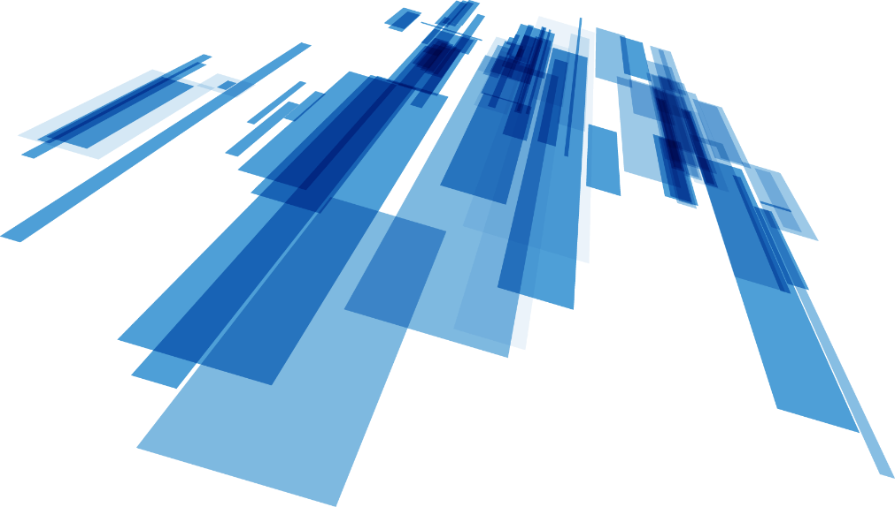

# SET_CVPR2025_dabian_20261110_20261110_221509

- Source: `SET_CVPR2025_dabian_20261110_20261110_221509.pptx`
- Total slides: 18

## Slide 1

兰州理工大学

SET：频域增强小目标检测

CVPR 2025 · 汇报人：XXX

### Speaker Notes

大家好，今天分享的是 CVPR 2025 的 SET，一篇从频域角度做小目标检测的工作。它最吸引我的点是：只改训练、不改推理，就能稳定涨点。

## Slide 2

[1](#slide-3)

[01. 问题与动机](#slide-3)

[2](#slide-7)

目录

[02. 频域洞察](#slide-7)

CONTENTS

[3](#slide-8)

[03. SET 方法](#slide-8)

[4](#slide-14)

[04. 实验与启示](#slide-14)

### Speaker Notes

我会按四个部分讲：问题与动机、频域洞察、SET 方法、实验与启示。重点放在它为什么有效，以及能不能迁移到我们的 VisDrone 和 EdgeCrafter 上。

## Slide 3

兰州理工大学

PART 01

问题与动机

Why are tiny objects still
hard for modern detectors?

### Speaker Notes

先看问题。小目标检测难，不是因为我们没有更强的检测器，而是目标本身在特征里就快消失了。

## Slide 4

小目标检测：一个仍未解决的难题

问题：小目标有多难

兰州理工大学

小目标（≤16×16
像素）经多层下采样后，
特征响应迅速衰减；在密集杂乱的背景中，
检测器很难把它与噪声区分开。

FCOS

DINO-5scale

37.6 → 9.9 AP

极tiny
目标仅
2.5 AP

AI-TOD

### Speaker Notes

AI-TOD 上，DINO 对中等目标能做到 37.6 AP，但对极tiny 目标只有 9.9；FCOS 更极端，只有 2.5。这个落差就是我们今天要解释和缓解的东西。

## Slide 5

为什么小目标这么难？

兰州理工大学

特征微弱

多次下采样后，
小目标的高频
响应迅速衰减。

分辨率低

目标仅占
16×16
像素，
纹理与形状信息极少。

背景杂乱

背景高频噪声强，
目标容
易被
淹没。

TOD 五大挑战

标注成本高

小目标标注困难、
漏标多，
数据规模
受限。

尺度跨度大

同一场景内目标从
2 像素到
100+
像素不等。

### Speaker Notes

我把难点拆成五条：分辨率低、特征微弱、背景杂乱、尺度跨度大、标注成本高。SET 主要针对前三条，尤其是背景高频噪声。

## Slide 6

从空间域到频域：换一个角度看小目标

兰州理工大学

在空间域增强特征

空间域

超分、特征模仿、
注意力、标签分配：
直接强化小目标，
但计算重、易被背景干扰。

在频域分析响应

频域

FFT 后按频段掩码，
观察不同尺度目标的响应：
小目标弱在高频，
背景高频才是噪声。

### Speaker Notes

现有方法基本都在空间域做增强：超分、特征模仿、注意力、标签分配。SET 换了个角度，先把特征变到频域，看不同尺度目标到底缺了哪个频段。

## Slide 7

兰州理工大学

PART 02

频域洞察

Occlusion-based attribution
in the frequency domain

### Speaker Notes

第二部分，频域洞察。这里的关键不是 FFT 本身，而是用遮挡归因的方式去问：去掉哪一段频率，检测性能会怎么变。

## Slide 8

频域遮挡归因：小目标缺的是什么？

兰州理工大学

P3

分析流程与发现

对 P3 做 FFT →
按频段掩码 → IFFT，
再用同一检测器评估 AP 变化。

FFT

IFFT

发现：小目标弱在高频；
去掉背景高频，tiny +15%。

Mask

### Speaker Notes

做法很直接：对 P3 特征做 FFT，按频段施加静态掩码，再 IFFT 回去，用同一个 FCOS 评估。结果是小目标弱在高频，而背景高频对它们主要是噪声。

## Slide 9

高频掩码：对谁有益，对谁有害

兰州理工大学

去掉高频

保留高频

VS

very tiny
+15%，
tiny +8%

中/大目标 −4%

关键发现

tiny

large

大目标依赖高频细节

掩码

全局去高频会伤大目标

小目标弱在高频，
背景高频
对它们是
噪声。

所以只平滑背景高频

1

2

3

### Speaker Notes

这就带来一个反直觉的结论：去掉高频，very tiny 能涨 15%，tiny 涨 8%；但中大目标反而掉 4%。所以不能全局去高频，只能动背景。

## Slide 10

兰州理工大学

PART 03

SET 方法

Heterogeneous refinement
for foreground and background

### Speaker Notes

第三部分，SET 怎么做。它由 HBS 和 API 两个模块组成，都只在训练期生效。

## Slide 11

SET 总览：一个训练期插件

兰州理工大学

特征解耦

按 GT mask
拆分为前景与背景特征。

SET

HBS 平滑

背景做尺度自适应压缩-扩张，
抑制高频噪声。

API 扰动

训练期注入特征级对抗扰动，
提升关键区域显著度。

### Speaker Notes

整体是三段：先按 GT mask 把前景背景拆开，再对背景做 HBS 平滑，最后在训练时注入 API 对抗扰动。推理时这两个模块都不在，所以零额外延迟。

## Slide 12

HBS：只平滑背景，不动前景

兰州理工大学

特征解耦

用 GT 框生成二值 mask
M，把 FPN 特征拆成前景与背景，
只对背景做平滑，前景原样保留。

自适应平滑

对背景做通道压缩再扩张
（r=4），高频细节在
压缩-重建中自然丢失。

尺度自适应核

第 i 层卷积核 K_i 由 FPN
stride 决定：低层小核、
高层大核，padding 保持分辨率。

### Speaker Notes

HBS 有三个设计点：用 GT 框生成二值 mask 做解耦；背景做通道压缩再扩张，高频在重建中自然丢失；卷积核大小随 FPN stride 变化，低层小核、高层大核。

## Slide 13

API：在显著度与稳定性之间取平衡

兰州理工大学

扰动太弱，
关键区域的显
著度提升有限。

ρ
过
小

添加标题

ρ
过
大

扰动太强，
辅助正则会压
过检测损失。

SET 取 ρ=1、λ=1：既提升
tiny 显著度，又不破坏大目标。

添加标题

### Speaker Notes

API 的关键是平衡：扰动太弱没有效果，太强又会压过检测损失。论文最后取 rho 等于 1、lambda 等于 1，在显著度和稳定性之间取折中。

## Slide 14

兰州理工大学

PART 04

实验与启示

Four datasets, zero
inference overhead

### Speaker Notes

第四部分，实验。作者在四个数据集上验证：AI-TOD、VisDrone、DOTA-v2.0 和 COCO。

## Slide 15

四个数据集上的一致增益

兰州理工大学

VisDrone2019

AI-TOD

FCOS +2.0
/ RFLA +1.3

RFLA +3.2
/ DINO +3.4

DOTA-v2.0

COCO2017

FCOS +2.9
/ AA +1.4

FCOS +1.0
/ AP_t +1.7

### Speaker Notes

主结果是 AI-TOD：RFLA 涨 3.2，DINO 涨 3.4。VisDrone 和 DOTA 上也是一致涨点，COCO 上 AP 涨 1.0、AP_t 涨 1.7。说明它不是只对某一个数据集调出来的。

## Slide 16

SET 给了我们什么

兰州理工大学

只平滑背景高频，就能提升 tiny 目标。

对抗扰动提升显著度，推理零开销。

结论

四个数据集上一致涨点。

对 RFLA / DINO 同样有效（+3.2 / +3.4）。

### Speaker Notes

总结一下：只平滑背景高频就能提升 tiny；对抗扰动提升显著度但不增加推理成本；四个数据集一致有效，而且对强基线也成立。

## Slide 17

可迁移性：四点启示

兰州理工大学

小目标问题

01

tiny 目标同样受高频影响。

下一步

VisDrone
复现 HBS。

启示

可插拔

04

02

只改训练，
不改推理结构。

零延迟

03

不加 FLOPs，延迟不变。

### Speaker Notes

对我们来说有三点：第一，VisDrone 的 tiny 目标同样受高频影响，值得先做频域诊断；第二，SET 只改训练，适合 EdgeCrafter 这种端侧模型；第三，它不加 FLOPs，可以做 INT8 量化后再验证增益是否保持。

## Slide 18

兰州理工大学

谢谢，欢迎讨论

汇报人：XXX

### Speaker Notes

以上就是这次分享，谢谢大家，欢迎讨论。
